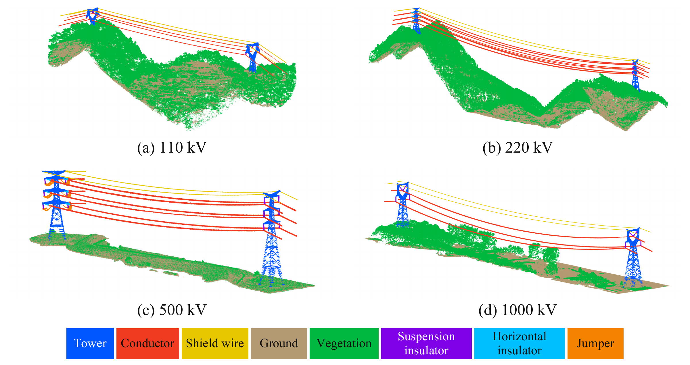

# SpanVolt3D

## A multi-voltage point-cloud dataset and benchmark for transmission corridor inspection

SpanVolt3D studies span-level transmission-corridor understanding across
**110, 220, 500 and 1000 kV**. The manuscript evaluates seven semantic
segmentation baselines on a fixed six-class benchmark and examines how semantic
errors affect inspection-oriented geometric measurements.



*Examples from the paper's native annotated scenes. The legend shows categories
visible in these examples. The native annotation scheme contains 13 codes;
the paper's segmentation benchmark uses six derived classes. These examples illustrate the study and the native annotation representation.*

**Manuscript status:** in preparation for submission to Earth System Science Data.

**Data release:** Native400 version 1.0 comprises all 400 native annotated
span-level scenes (5,879,971,739 points; 13 native annotation codes), deposited
in Zenodo for peer review under **CC BY 4.0**. The native LAS files are
losslessly compressed as LAZ and distributed in independently extractable ZIP
archives. The reserved dataset DOI is
[10.5281/zenodo.24503872](https://doi.org/10.5281/zenodo.24503872).
While the deposit remains a draft, its DOI may not resolve; an anonymous
review link is supplied with the manuscript. The review token is not published
in this repository. Public DOI access will be enabled when the record is published.

**Data contact:** [feibobo721@outlook.com](mailto:feibobo721@outlook.com).

## Dataset and paper protocol

The complete study corpus contains **400 scenes**: 11 / 107 / 276 / 6 at
110 / 220 / 500 / 1000 kV. Native files retain **13 project-specific annotation
codes**, including auxiliary states. The derived six-class benchmark comprises
tower, conductor, jumper conductor, insulator, shield wire and vegetation.

The paper uses seven baselines, XYZ-only model inputs, three training seeds
and fixed project-grouped splits. The public scene manifest documents the
complete historical protocol. The Zenodo metadata link the native release
identifiers to these experiment scene identifiers and fixed assignments.

See [dataset and protocol](docs/dataset_and_protocol.md),
[label definitions and processing](docs/data_details.md), and
[verification records and limits](docs/reproducibility.md).

## Data release and access

| Material | Release scope |
| --- | --- |
| Native annotated scenes | All 400 scenes in Zenodo Native400 v1.0, retaining native codes 0–12; losslessly compressed LAZ in independent ZIP archives; CC BY 4.0 |
| Frozen six-class NPY benchmark files | Derived experimental representation; not separately distributed |
| Original continuous engineering surveys and line-project materials | Outside the release scope |
| Label definitions, anonymous historical splits, preparation/evaluation code and archived scores | Included in this repository |

The Native400 v1.0 data and semantic labels use **CC BY 4.0**. The former
email-approval, non-commercial and non-redistribution conditions do not apply
to this release. See [data access and licensing](DATA_ACCESS.md) for attribution
and version information. The MIT software licence is separate from the data licence.

The complete frozen six-class NPY benchmark, pretrained model weights,
per-point predictions and Section 4.4 clearance application code are not
included in the current public package. The provided conversion functions and
per-scene metadata document how native scenes relate to the historical six-class
experiments; [verification limits](docs/reproducibility.md) remain explicit.

## Code and repository contents

This repository contains **data preparation and semantic segmentation benchmark
code**. Section 4.4 application code is not included. No point-cloud files,
per-point predictions, model weights or private engineering inventories are
included in this repository.

| Location | Content |
| --- | --- |
| `metadata/` | Native labels, benchmark classes and the mapping |
| `splits/scene_manifest.csv` | Complete historical 400-scene protocol, anonymous groups, recorded hashes and seeds |
| `preprocessing/` | LAS reader, numerical conversion functions and complete-corpus tools |
| `configs/` | Seven models × three saved seed configurations |
| `runtime/` | Selected Pointcept and PointNet++ implementations and extension source |
| `scripts/run_benchmark.py` | Command inspection, training and test entry |
| `evaluation/` | Metric kernels and three-seed aggregation |
| `results/` | Archived XYZ-only scores and summaries |
| `environments/` | Recorded dependency recipe, build notes and source identities |

SpUNet uses Pointcept's **spconv** implementation, PTv2 uses **Mode 2**, and
LitePT uses **LitePT-S with the v1m1 lightweight decoder**. See
[model instructions](configs/README.md) and
[environment instructions](environments/README.md). The recorded environment
recipe is not a complete historical package lock.

## Quick start

### Checks that do not require the point-cloud corpus

Run commands from the repository root. The synthetic metric example requires
NumPy; historical score aggregation uses the Python standard library.

```bash
python3 evaluation/evaluate.py --implementation pointcept --confusion evaluation/synthetic_counts.json
python3 evaluation/aggregate.py --scores results/historical_xyz_seed_results.csv --output-dir /path/to/new_summary_directory
python3 scripts/run_benchmark.py --action train --model ptv3 --seed 42 --data-root /path/to/benchmark6 --output runs/ptv3/seed42 --dry-run
```

These commands inspect interfaces and archived records. They do not run new
training or inference. The metric example returns fractional values; archived
score aggregation uses percentage values and sample SD (`ddof=1`).

### Working with Native400 scenes

Extract the independent ZIP archives, then losslessly decompress LAZ to LAS
before using the supplied native-data reader. This reader uses an uncompressed
LAS memory map and does not directly decode LAZ or ZIP files. Use the Zenodo
metadata to associate each native scene with the `SCENE_####.las` basename
required by `native_filename` in `splits/scene_manifest.csv`; preserve original
point order, coordinates, scale and offsets. Do not apply further coordinate
translation, normalisation, rotation or resampling when reconstructing the
historical benchmark.

The native `classification` codes are defined in
[`metadata/native_labels.csv`](metadata/native_labels.csv). These are
project-specific codes, not the generic LAS classification table. A scene
contains the categories present in that scene, not necessarily all 13 codes.

The existing `build_benchmark.py` and `verify_benchmark.py` command-line tools
require the complete fixed 400-scene corpus. They do not accept a shortened
manifest. Use the recorded numeric `sampling_seed` values rather than hashing
new public paths, and retain each recorded `benchmark_sha256` check. Rebuilt
point clouds can be used for alternative tasks; only outputs matching the
recorded historical hashes establish the same stored experimental input bytes.

### Complete historical benchmark tools

These commands document the full-corpus workflow and require all corresponding
historical inputs. Their availability does not mean that the data can be
downloaded directly from this repository.

```bash
python3 preprocessing/verify_benchmark.py --data-root /path/to/benchmark6
python3 preprocessing/verify_benchmark.py --data-root /path/to/benchmark6 --sha256
python3 preprocessing/build_benchmark.py --native-root /path/to/native --output-root /path/to/benchmark6 --dry-run
```

Do not repeat label filtering or 0.30-m sampling on frozen six-class arrays.
Actual training/test commands and their input requirements are in
[configs/README.md](configs/README.md); historical result-reader conventions
are in [evaluation details](docs/evaluation_details.md).

## Benchmark protocol

- Train/val/ID/OOD-110/OOD-1000: **253/68/62/11/6** scenes and **4/2/2/3/2**
  project groups; no project group crosses subsets.
- **XYZ only**. Filter and map native labels, sample at **0.30 m** by retaining
  the first point per voxel, then cap only above **1,000,000 points**.
- Model grid **0.08 m**; training crops and test chunks at most **60,000 points**.
- Seven models, **200 data passes**, seeds **42/3407/9173**. Select by validation
  mIoU and fix that checkpoint across ID/OOD; no OOD tuning.
- Sum point-level counts within each domain before computing IoU/mIoU/mAcc/OA;
  summarize seeds with **sample SD (`ddof=1`)**.

## Paper and contact

**Title:** *SpanVolt3D: an annotated point-cloud dataset of transmission corridors across four voltage levels*.

**Status:** manuscript in preparation for submission; no publication DOI is
claimed.

| Confirmed role | Name | Contact |
| --- | --- | --- |
| First author and data contact | Huiyang Wan (万惠炀) | [feibobo721@outlook.com](mailto:feibobo721@outlook.com) |
| Corresponding author | Jian Yang (杨健) | [yangjian@cug.edu.cn](mailto:yangjian@cug.edu.cn) |

**Affiliation:** School of Geography and Information Engineering, China
University of Geosciences, Wuhan 430074, China.

The dataset creators, version and citation are recorded in Zenodo. Cite the
specific Native400 dataset version and identify the scenes and processing used
in research outputs. Cite the accompanying paper when its citation is available.
The table above identifies the data and correspondence contacts.

## Funding

This work was supported by the National Natural Science Foundation of China
(Grant Nos. **42271388** and **42171347**) and the Natural Science Foundation of
Hubei Province (Grant No. **2024AFA069**).

## Licensing

Original SpanVolt3D software contributions are provided under the
[MIT License](LICENSE). Third-party code retains its existing notices and
licenses; see [THIRD_PARTY_NOTICES.md](THIRD_PARTY_NOTICES.md) and
[licensing scope](LICENSING.md).

The software license does **not** grant access to or rights over the point
clouds and semantic labels. Those are governed separately by
[DATA_ACCESS.md](DATA_ACCESS.md).
