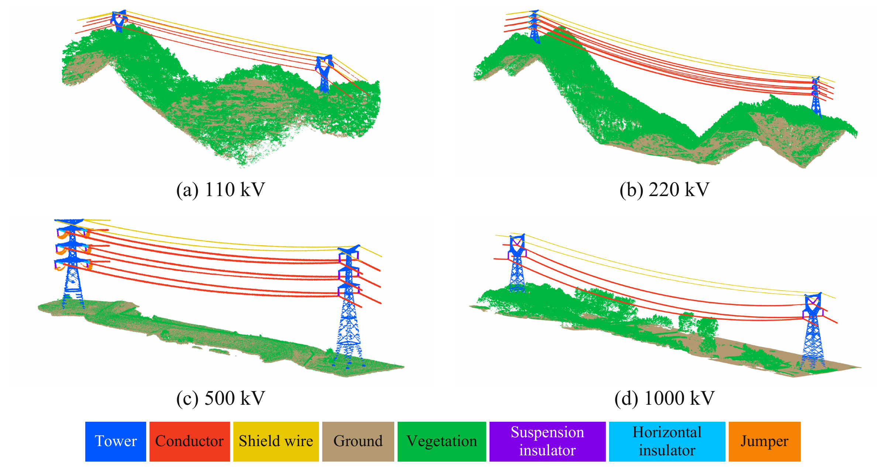

# SpanVolt3D

## A multi-voltage point-cloud dataset and benchmark for transmission corridor inspection

SpanVolt3D studies span-level transmission-corridor understanding across
**110, 220, 500 and 1000 kV**. The manuscript evaluates seven semantic
segmentation baselines on a fixed six-class benchmark and examines how semantic
errors affect inspection-oriented geometric measurements.



*Examples from the paper's native annotated scenes. The legend shows categories
visible in these examples. The native annotation scheme contains 13 codes;
the paper's segmentation benchmark uses six derived classes. These examples
illustrate the study and do not identify the scenes approved for a data request.*

**Manuscript status:** in preparation for submission.  
**Current data access:** approved subsets of labelled, already segmented LAS
scenes, by email request, for non-commercial research by universities and
research institutions.  
**Data contact:** [feibobo721@outlook.com](mailto:feibobo721@outlook.com).

## Dataset and paper protocol

The complete study corpus contains **400 scenes**: 11 / 107 / 276 / 6 at
110 / 220 / 500 / 1000 kV. Native files retain **13 project-specific annotation
codes**, including auxiliary states. The derived six-class benchmark comprises
tower, conductor, jumper conductor, insulator, shield wire and vegetation.

The paper uses seven baselines, XYZ-only model inputs, three training seeds
and fixed project-grouped splits. The public scene manifest documents that
complete historical protocol. **It is not a list of files automatically
provided to an applicant.**

See [dataset and protocol](docs/dataset_and_protocol.md),
[label definitions and processing](docs/data_details.md), and
[verification records and limits](docs/reproducibility.md).

## Current data access

| Material | Current access arrangement |
| --- | --- |
| Already segmented, labelled native LAS | Approved scene/project subsets may be supplied by email request; native codes 0–12 are retained |
| Complete 400-scene native corpus | Not included in the current access offer |
| Complete frozen six-class NPY benchmark | Described for the paper's historical protocol; not included in the current access offer |
| Complete original engineering point clouds and line-project materials | Not provided |
| Label definitions, anonymous historical splits, preparation/evaluation code and archived scores | Included in this repository |

Data requests are considered for **non-commercial research by universities and
research institutions**. Research access is free of charge. Commercial use
and redistribution of the supplied point clouds or labels are not permitted.
An approved delivery may contain selected scenes from one project; the exact
scope and delivery method are confirmed for each request.

Email [feibobo721@outlook.com](mailto:feibobo721@outlook.com) with your name,
institution, research team, research purpose and requested scene scope.
The [request template](docs/data_request_template.txt) can be copied into an
email. Read [Data access and use conditions](DATA_ACCESS.md) before requesting
data. A delivery will include its own anonymous scene/file list and label
definitions.

**Access to a project subset does not provide all inputs needed to reproduce
the paper's complete training, ID and cross-voltage test results.** The full
400-scene inventory and fixed splits remain available as protocol records.

## Code and repository contents

This repository contains **data preparation and semantic segmentation benchmark
code**. Section 4.4 application code is not included. No point-cloud files,
per-point predictions, model weights or private engineering inventories are
included in this repository.

| Location | Content |
| --- | --- |
| `metadata/` | Native labels, benchmark classes and the mapping |
| `splits/scene_manifest.csv` | Complete historical 400-scene protocol, anonymous groups, recorded hashes and seeds |
| `preprocessing/` | LAS reader, numerical conversion functions and complete-corpus tools |
| `configs/` | Seven models × three saved seed configurations |
| `runtime/` | Selected Pointcept and PointNet++ implementations and extension source |
| `scripts/run_benchmark.py` | Command inspection, training and test entry |
| `evaluation/` | Metric kernels and three-seed aggregation |
| `results/` | Archived XYZ-only scores and summaries |
| `environments/` | Recorded dependency recipe, build notes and source identities |

SpUNet uses Pointcept's **spconv** implementation, PTv2 uses **Mode 2**, and
LitePT uses **LitePT-S with the v1m1 lightweight decoder**. See
[model instructions](configs/README.md) and
[environment instructions](environments/README.md). The recorded environment
recipe is not a complete historical package lock.

## Quick start

### Checks that do not require the point-cloud corpus

Run commands from the repository root. The synthetic metric example requires
NumPy; historical score aggregation uses the Python standard library.

```bash
python3 evaluation/evaluate.py --implementation pointcept --confusion evaluation/synthetic_counts.json
python3 evaluation/aggregate.py --scores results/historical_xyz_seed_results.csv --output-dir /path/to/new_summary_directory
python3 scripts/run_benchmark.py --action train --model ptv3 --seed 42 --data-root /path/to/benchmark6 --output runs/ptv3/seed42 --dry-run
```

These commands inspect interfaces and archived records. They do not run new
training or inference. The metric example returns fractional values; archived
score aggregation uses percentage values and sample SD (`ddof=1`).

### Working with an approved native LAS subset

Use the delivered scene list and the native `classification` codes in
[`metadata/native_labels.csv`](metadata/native_labels.csv). These are
project-specific codes; do not substitute a generic LAS classification table.
Each scene contains the categories present in that scene, not necessarily all
13 codes.

The supplied LAS may be used directly for the approved research. The existing
`build_benchmark.py` and `verify_benchmark.py` command-line tools require the
complete fixed 400-scene corpus. **They do not accept a project subset, and
trimming the public manifest does not turn them into subset tools.** Their
numerical conversion functions and the six-class mapping remain documented
for inspection and authorized use.

### Complete historical benchmark tools

These commands document the full-corpus workflow and are only applicable to
someone who already has all corresponding historical inputs. They are not
instructions to request a complete delivery under the current access offer.

```bash
python3 preprocessing/verify_benchmark.py --data-root /path/to/benchmark6
python3 preprocessing/verify_benchmark.py --data-root /path/to/benchmark6 --sha256
python3 preprocessing/build_benchmark.py --native-root /path/to/native --output-root /path/to/benchmark6 --dry-run
```

Do not repeat label filtering or 0.30-m sampling on frozen six-class arrays.
Actual training/test commands and their input requirements are in
[configs/README.md](configs/README.md); historical result-reader conventions
are in [evaluation details](docs/evaluation_details.md).

## Benchmark protocol

- Train/val/ID/OOD-110/OOD-1000: **253/68/62/11/6** scenes and **4/2/2/3/2**
  project groups; no project group crosses subsets.
- **XYZ only**. Filter and map native labels, sample at **0.30 m** by retaining
  the first point per voxel, then cap only above **1,000,000 points**.
- Model grid **0.08 m**; training crops and test chunks at most **60,000 points**.
- Seven models, **200 data passes**, seeds **42/3407/9173**. Select by validation
  mIoU and fix that checkpoint across ID/OOD; no OOD tuning.
- Sum point-level counts within each domain before computing IoU/mIoU/mAcc/OA;
  summarize seeds with **sample SD (`ddof=1`)**.

## Paper and contact

**Title:** *SpanVolt3D: A multi-voltage point-cloud dataset and benchmark for
transmission corridor inspection*.

**Status:** manuscript in preparation for submission; no publication DOI is
claimed.

| Confirmed role | Name | Contact |
| --- | --- | --- |
| First author and data contact | Huiyang Wan (万惠炀) | [feibobo721@outlook.com](mailto:feibobo721@outlook.com) |
| Corresponding author | Jian Yang (杨健) | [yangjian@cug.edu.cn](mailto:yangjian@cug.edu.cn) |

**Affiliation:** School of Geography and Information Engineering, China
University of Geosciences, Wuhan 430074, China.

The table records the confirmed roles, not a finalized complete author list.
Formal citation metadata will be added when that list and manuscript details
are finalized. Research outputs using supplied data should acknowledge
SpanVolt3D, identify the approved subset, and cite the accompanying paper when
its citation becomes available.

## Funding

This work was supported by the National Natural Science Foundation of China
(Grant Nos. **42271388** and **42171347**) and the Natural Science Foundation of
Hubei Province (Grant No. **2024AFA069**).

## Licensing

Original SpanVolt3D software contributions are provided under the
[MIT License](LICENSE). Third-party code retains its existing notices and
licenses; see [THIRD_PARTY_NOTICES.md](THIRD_PARTY_NOTICES.md) and
[licensing scope](LICENSING.md).

The software license does **not** grant access to or rights over the point
clouds and semantic labels. Those are governed separately by
[DATA_ACCESS.md](DATA_ACCESS.md).
